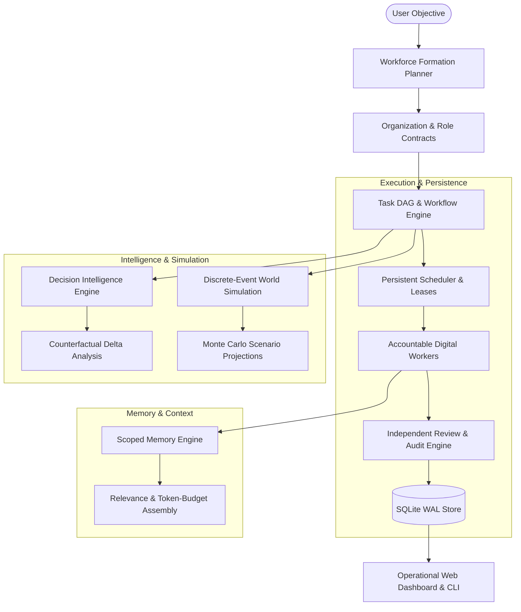

# SimArch — Simulation Architecture

> **Autonomous AI Organizations · Persistent Digital Workforce · Decision Intelligence · Time-Compressed World Simulation**

[](LICENSE)
[](pyproject.toml)
[-success.svg)](tests/)
[](docs/architecture.md)

---

## 1. What is SimArch?

**Build an organization. Give it a mission. Watch it work.**

SimArch is an open-source platform for orchestrating **autonomous AI organizations**, operating **persistent digital workforces**, evaluating **decision intelligence graphs**, and conducting **time-compressed discrete-event world simulations**.

Unlike conversational agent frameworks, chatbot wrappers, or static workflow pipelines, SimArch treats AI agents as **accountable corporate employees**. Workers occupy defined organizational roles, operate under enforceable contracts and budgets, collaborate across departments, produce verifiable evidence rather than chat messages, undergo independent audit review, and simulate strategic decisions across alternate timelines before committing capital.

---

## 2. Core Differences

| Feature | Conventional Multi-Agent Frameworks | SimArch Autonomous Organizations |
| :--- | :--- | :--- |
| **Accountability** | Chat messages declaring completion | Verifiable deliverables, evidence, and independent review verdicts |
| **Governance** | Unconstrained prompt descriptions | Enforceable role contracts, tool permissions, and budget caps |
| **Persistence** | Ephemeral browser or memory sessions | Persistent SQLite WAL store with worker leases and crash recovery |
| **Coordination** | Ad-hoc message flooding | Directed task DAGs, topological unblocking, and bounded recursion |
| **Decisions** | Opaque prompt conclusions | Directed decision graphs, binary alternative trees, and counterfactual analysis |
| **Simulation** | Wall-clock sleep cycles | Discrete-event simulation advancing through months/years with causal loops |
| **Inference Cost** | Requires expensive external API keys | Zero-cost deterministic local provider for 100% offline development |

---

## 3. Architecture Overview

SimArch is organized as a modular monolith with strict interface contracts between subsystems:



---

## 4. Installation & First Run

### Prerequisites
- Python 3.10 or higher (Python 3.13 tested and verified)
- SQLite 3.35+ (standard library)

### Quick Install
```bash
git clone https://github.com/simarch/simarch.git
cd simarch
pip install -e .
```

### Zero-Cost Smoke Test (No API keys required)
Run the complete end-to-end first organization demonstration immediately:
```bash
simarch smoke-test
```
or run directly via Python:
```bash
python3 examples/first_organization.py
```

### Launch the Operational Dashboard
```bash
simarch serve --port 8400
```
Open [http://127.0.0.1:8400](http://127.0.0.1:8400) to view:
- **Organization Hierarchy**: Role contracts, decision authority, and budget limits.
- **Projects & Task DAG**: Real-time dependency unblocking and deliverables.
- **Decision Intelligence**: Winner selection rationale and binary alternative comparison trees.
- **World Simulation**: 12-month discrete-event causal projections and Monte Carlo runs.
- **Audit Log**: Immutable runtime state transition records.

---

## 5. Complete Working Example

Below is a complete script demonstrating dynamic organization synthesis, task execution, deliverable auditing, multi-criteria decision intelligence, and process restart recovery:

```python
from pathlib import Path
from simarch.db.database import DatabaseManager
from simarch.org.formation import WorkforceFormationPlanner
from simarch.execution.engine import TaskEngine
from simarch.execution.models import Task, Deliverable
from simarch.execution.review import ReviewEngine
from simarch.decision.intelligence import DecisionIntelligence
from simarch.decision.models import DecisionRecord, DecisionAlternative, EvaluationCriterion

# 1. Initialize Persistent Database
db = DatabaseManager("./simarch_demo.db")
formation = WorkforceFormationPlanner(db)
task_engine = TaskEngine(db)
review_engine = ReviewEngine(db)
decision_intel = DecisionIntelligence(db)

# 2. Form Autonomous Organization from Objective
org = formation.synthesize_organization(
    name="Apex Intelligence Labs",
    objective="Research autonomous AI organizations and verify decision architectures.",
    scale="compact"
)
print(f"Formed Organization: {org.name} with {len(org.roles)} roles")

# 3. Create Strategic Project & Tasks
project = task_engine.create_project(org.id, "SimArch Launch", org.mission)
lead_role = list(org.roles.values())[1]

task = Task(
    project_id=project.id,
    org_id=org.id,
    assigned_role_id=lead_role.id,
    objective="Author architectural specification with zero circular dependencies",
    acceptance_criteria=["Document contracts", "Ensure zero circular dependencies"]
)
task_engine.add_task(task)

# 4. Deliverable Submission & Independent Audit
deliverable = Deliverable(
    summary="Specification completed. Contracts documented with zero circular dependencies verified.",
    evidence=["Document contracts verified in test suite", "Ensure zero circular dependencies validated"]
)
task_engine.save_deliverable(task.id, deliverable)

auditor_role = list(org.roles.values())[-1]
verdict = review_engine.evaluate_deliverable(task, auditor_role.id, deliverable)
print(f"Independent Review: {verdict.status.value.upper()} - {verdict.feedback}")

# 5. Multi-Criteria Decision Intelligence
decision = DecisionRecord(
    project_id=project.id,
    org_id=org.id,
    owner_role_id=lead_role.id,
    objective="Select storage backend for persistent worker state",
    criteria=[
        EvaluationCriterion(name="Simplicity", weight=0.5, description="Zero ops cluster"),
        EvaluationCriterion(name="Throughput", weight=0.5, description="ACID performance")
    ],
    alternatives=[
        DecisionAlternative(name="SQLite WAL", estimated_cost=0.0, scores={"Simplicity": 10.0, "Throughput": 8.5}),
        DecisionAlternative(name="Distributed Cluster", estimated_cost=10000.0, scores={"Simplicity": 3.0, "Throughput": 9.0})
    ]
)
evaluated_dec = decision_intel.evaluate_and_select(decision)
print(f"Winning Option: {evaluated_dec.chosen_option}")
print(f"Rationale: {evaluated_dec.reasons_for_selection}")
```

---

## 6. Real Execution Output

Below is the verified output produced during automated execution of the smoke test:

```text
════════════════════════════════════════════════════════════════════
       SIMARCH END-TO-END DEMONSTRATION: FIRST ORGANIZATION         
════════════════════════════════════════════════════════════════════

Step 1: Business Objective:
  Research autonomous AI architecture and implement an evidence-backed verification engine.

Step 2: Organization Formed: Nexus Research Labs (org_8946f305fb10)
  • Project Coordinator (coordinator) - Authority: ['*']
  • Lead Research Analyst (specialist) - Authority: ['technical_implementation', 'task_execution']
  • Quality & Verification Auditor (auditor) - Authority: ['deliverable_review', 'compliance_signoff']

Step 3: Strategic Project Initialized: SimArch Genesis (proj_09fdb7fd8c2f)
  • Task 1 created: Design architectural specification and modular component contracts. (READY)
  • Task 2 created: Implement verification state machine and independent review protocol. (BLOCKED - waiting for Task 1)

Step 4: Task 1 Delivered & Audited: APPROVED by Quality & Verification Auditor
  • Task 2 status automatically promoted: READY

Step 5: Decision Intelligence Evaluated:
  • Decision: Select primary runtime persistence engine for digital workforce state.
  • Selected Winner: SQLite with WAL & Thread-Safe Leases
  • Rationale: Alternative 'SQLite with WAL & Thread-Safe Leases' achieved the highest weighted utility score (9.33/10.0). Expected benefit: $9,500.00 at estimated cost: $0.00 with low risk.
  • Binary Comparison vs Runner-up: Distributed Multi-Node Cluster
  • Flip Condition: If Distributed Multi-Node Cluster's cost dropped by $15,000.00 or risk decreased from high to low.
  • Counterfactual Cost Delta: +$15,000.00

Step 6: Discrete-Event Simulation Executed:
  • Simulated 365 Days: Final Cash = $-2,200.00, Customers = 131

Step 7: Verifying Process Restart & Persistent Recovery:
  • Successfully recovered Project: SimArch Genesis (ACTIVE)
  • Task 1 recovered in terminal state: COMPLETED
  • Task 2 recovered in ready state: READY

✓ FIRST ORGANIZATION SMOKE TEST PASSED COMPREHENSIVELY.
```

---

## 7. Command-Line Reference

SimArch provides a comprehensive CLI for headless scripting and operational automation:

| Command | Description |
| :--- | :--- |
| `simarch init [--path PATH]` | Initialize database, WAL configuration, and workspace directories |
| `simarch smoke-test` | Run complete end-to-end reproducible first organization verification |
| `simarch org create --name <name> --objective <text>` | Dynamically synthesize an organization graph and role contracts |
| `simarch org list` | List all persisted organizations and executive hierarchies |
| `simarch project start --org <id> --name <name> --objective <text>` | Launch a new strategic initiative |
| `simarch project status <project-id>` | Inspect project task DAG, deliverables, and worker lease states |
| `simarch project pause <project-id>` | Pause execution of an active initiative |
| `simarch project resume <project-id>` | Resume execution of a paused initiative |
| `simarch decision inspect <decision-id>` | Inspect multi-criteria evaluation, winning rationale, and binary tree |
| `simarch sim run --duration <days> --marketing <amount>` | Execute discrete-event simulation with causal feedback loops |
| `simarch serve [--host HOST] [--port PORT]` | Launch the operational web dashboard and REST API |

---

## 8. Discrete-Event Simulation Engine

SimArch separates human wall-clock time from simulated time. Simulating 5 years of company dynamics executes in milliseconds:

- **Explicit World State**: Tracks cash, monthly burn, revenue, customer count, headcount, product readiness, and churn.
- **Causal Feedback Loops**:
  $$\text{Burn} = (\text{Team Size} \times \text{Salary}) + \text{Marketing Spend}$$
  $$\Delta \text{Customers} = \left(\frac{\text{Marketing Budget}}{\text{CAC}}\right) \times \left(1 + \frac{\text{Product Readiness}}{100}\right) - \text{Churn}$$
- **Monte Carlo Analysis**: Evaluates parameter distributions across varying seeds to calculate $P_{10}$, $P_{50}$, $P_{90}$, and runway exhaustion probabilities.

---

## 9. Scoped Memory & Context Isolation

Memories are strictly partitioned into isolated scopes:
- `ORGANIZATION`: Core company policies, bylaws, and shared guidelines.
- `DEPARTMENT`: Functional procedures (engineering, finance, research).
- `PROJECT`: Initiative milestones, acceptance criteria, and shared artifacts.
- `EMPLOYEE`: Private working notes (access restricted from peer specialists).
- `TASK`: Ephemeral execution scratchpads.

**Contradiction Guard**: When new entries directly conflict with existing assertions, a contradiction flag is raised and the entry is downweighted during context retrieval.

---

## 10. Controlled Self-Improvement Loop

SimArch adapts and refines workflows via a formal lifecycle:

$$\text{OBSERVE} \longrightarrow \text{PROPOSE} \longrightarrow \text{EVALUATE} \longrightarrow \text{APPROVE} \longrightarrow \text{VERSION} \longrightarrow \text{DEPLOY} \longrightarrow \text{MONITOR} \longrightarrow \text{ROLLBACK}$$

**Security Invariant**: The self-improvement engine strictly prohibits modifying security policies, authorization rules, permission boundaries, or core runtime code. Any proposal containing unauthorized overrides is rejected immediately.

---

## 11. Configuration & Model Providers

SimArch operates 100% locally with zero external API keys required by default. To connect hosted models, configure optional environment variables:

| Variable | Description | Default |
| :--- | :--- | :--- |
| `SIMARCH_HOME` | Directory for persistent database and workspaces | `~/.simarch` or `./.simarch` |
| `SIMARCH_DEFAULT_MODEL` | Default inference model router profile | `deterministic-local` |
| `OPENAI_API_KEY` | Optional key for GPT-4o / hosted planning | `None` (auto-falls back if unset) |
| `ANTHROPIC_API_KEY` | Optional key for Claude 3.5 Sonnet | `None` (auto-falls back if unset) |
| `GEMINI_API_KEY` | Optional key for Gemini 1.5 Pro/Flash | `None` (auto-falls back if unset) |

---

## 12. Security Considerations

- **Principle of Least Privilege**: Roles only possess tools and decision scopes explicitly granted in their contracts.
- **Lease Expiration**: Distributed locks automatically expire after 30 seconds unless sustained by active worker heartbeats.
- **Path Traversal Protection**: Temporary workspaces validate all paths against sandbox root boundaries before reading or writing.
- **Audit Immutability**: All task transitions, reviews, decisions, and administrative actions append to an indexed audit log.

---

## 13. Current Limitations & Roadmap

### Current Capabilities (v0.1.0 Implemented)
- [x] Dynamic organization synthesis & role contracts
- [x] Task DAG dependency resolution & topological unblocking
- [x] SQLite WAL persistence with worker leases and crash recovery
- [x] Independent deliverable review & audit protocol
- [x] Multi-criteria decision intelligence, binary trees & counterfactual analysis
- [x] Discrete-event simulation engine with Monte Carlo evaluation
- [x] Scoped memory isolation & contradiction detection
- [x] Zero-cost deterministic local model provider
- [x] Operational web dashboard & Typer CLI
- [x] 33 verified tests with 84% test coverage

### Planned Roadmap
- [ ] Distributed PostgreSQL storage backend driver
- [ ] Model Context Protocol (MCP) server & client connector
- [ ] Live streaming telemetry over WebSockets in dashboard
- [ ] Sandboxed Docker container execution for arbitrary code tasks

---

## 14. Contributing

We welcome contributions from the community! Please read our [Contributing Guide](CONTRIBUTING.md) and [Code of Conduct](CODE_OF_CONDUCT.md) before opening a pull request.

To run test suite locally:
```bash
pytest tests -v --cov=simarch
```

---

## 15. License

SimArch is released under the [Apache License, Version 2.0](LICENSE).

---

## 16. Citation

If you use SimArch in academic or industrial research, please cite:

```bibtex
@software{simarch2026,
  author = {SimArch Contributors},
  title = {SimArch: Simulation Architecture for Autonomous AI Organizations & Persistent Digital Workforce},
  year = {2026},
  url = {https://github.com/simarch/simarch}
}
```
