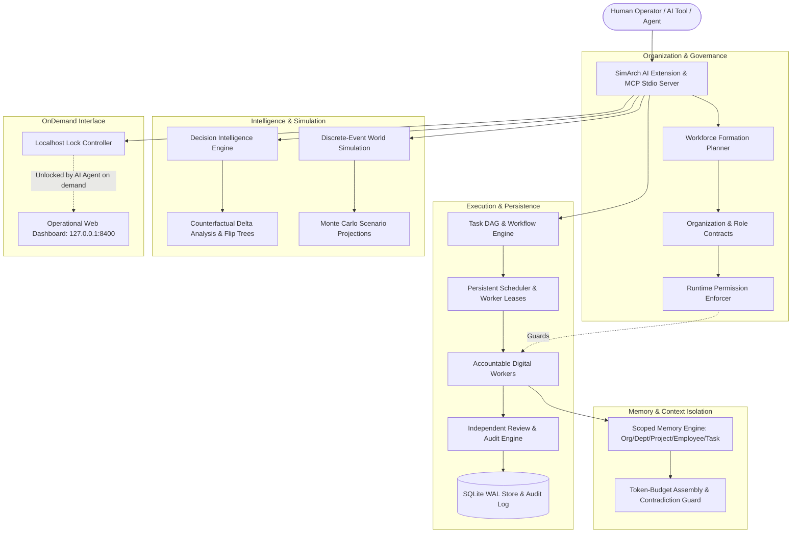

# SimArch — Simulation Architecture

> **Autonomous AI Organizations · Persistent Digital Workforce · Decision Intelligence · Time-Compressed World Simulation · Hardwired AI Tool Extension**

[](LICENSE)
[](pyproject.toml)
[-success.svg)](tests/)
[](docs/ai_extension_guide.md)
[](#41-localhost-locking-policy-the-ai-agent-decides)
[](https://github.com/isiraglobal/SimArch)

---

## Table of Contents

- [1. What is SimArch?](#1-what-is-simarch)
- [2. How SimArch Differs from Conventional Agent Frameworks](#2-how-simarch-differs-from-conventional-agent-frameworks)
- [3. Complete Architecture Overview](#3-complete-architecture-overview)
- [4. Hardwired AI Extension & Localhost Locking](#4-hardwired-ai-extension--localhost-locking)
  - [4.1 Localhost Locking Policy (The AI Agent Decides)](#41-localhost-locking-policy-the-ai-agent-decides)
  - [4.2 Native Model Context Protocol (MCP) Server](#42-native-model-context-protocol-mcp-server)
  - [4.3 Tool Configuration for Claude Code, Cursor, Windsurf, & Agents](#43-tool-configuration-for-claude-code-cursor-windsurf--agents)
  - [4.4 Complete MCP Tools Reference](#44-complete-mcp-tools-reference)
- [5. Core Architectural Pillars](#5-core-architectural-pillars)
  - [5.1 Workforce Formation & Enforceable Role Contracts](#51-workforce-formation--enforceable-role-contracts)
  - [5.2 10-State Task Lifecycle & Persistent DAG Execution](#52-10-state-task-lifecycle--persistent-dag-execution)
  - [5.3 Independent Deliverable Review & Audit Protocol](#53-independent-deliverable-review--audit-protocol)
  - [5.4 Decision Intelligence & Binary Counterfactual Trees](#54-decision-intelligence--binary-counterfactual-trees)
  - [5.5 Time-Compressed Discrete-Event World Simulation](#55-time-compressed-discrete-event-world-simulation)
  - [5.6 Scoped Memory Isolation & Contradiction Guard](#56-scoped-memory-isolation--contradiction-guard)
  - [5.7 Controlled Self-Improvement Loop](#57-controlled-self-improvement-loop)
- [6. Installation & Quickstart](#6-installation--quickstart)
  - [6.1 Installation](#61-installation)
  - [6.2 Zero-Cost Smoke Test (100% Offline)](#62-zero-cost-smoke-test-100-offline)
  - [6.3 On-Demand Operational Web Dashboard](#63-on-demand-operational-web-dashboard)
- [7. Python Agentic SDK Usage](#7-python-agentic-sdk-usage)
- [8. Real Execution Output (Smoke Test)](#8-real-execution-output-smoke-test)
- [9. Command-Line Interface (CLI) Reference](#9-command-line-interface-cli-reference)
- [10. Repository Directory Layout](#10-repository-directory-layout)
- [11. Configuration & Model Providers](#11-configuration--model-providers)
- [12. Security Architecture & Invariants](#12-security-architecture--invariants)
- [13. Current Capabilities & Roadmap](#13-current-capabilities--roadmap)
- [14. Contributing](#14-contributing)
- [15. License](#15-license)
- [16. Citation](#16-citation)

---

## 1. What is SimArch?

**Build an organization. Give it a mission. Watch it work.**

**SimArch** (Simulation Architecture) is an open-source platform for orchestrating **autonomous AI organizations**, operating **persistent digital workforces**, evaluating **decision intelligence graphs**, and executing **time-compressed discrete-event world simulations**.

SimArch is also designed to be **hardwired directly as an extension into modern AI tools and agents** (Claude Code, Cursor, Windsurf, Antigravity, and autonomous Python swarms).

### Why SimArch?
Most multi-agent frameworks treat AI agents as conversational chat partners passing prompts back and forth. When applied to real-world software, research, or enterprise automation, chat-based frameworks suffer from:
- **No real accountability**: Declaring "I have completed the task" in natural language without verifiable artifacts or code checks.
- **Unconstrained execution**: Agents operating with unbounded tool privileges, circular dependencies, and infinite loops.
- **Lost state upon crash**: Ephemeral memory lost whenever a process restarts or an exception occurs.
- **No strategic foresight**: Inability to simulate organizational consequences (burn, churn, customer acquisition, runway) across months or years before executing.
- **Always-on localhost bloat**: Spawning persistent background HTTP servers that occupy ports and consume resources when an agent only needs tool calling.

SimArch solves this by treating AI agents as **contract-bound corporate employees**:
1. Workers belong to formal **Role Contracts** with strict authority scopes, tool permissions, and budget caps.
2. Work moves through a **10-state persistent task DAG** in SQLite with WAL mode, distributed leases, and crash recovery.
3. Every completed task requires an **independent review verdict** from an auditor role before unblocking dependent tasks.
4. Strategic decisions are scored using **multi-criteria utility graphs** and binary counterfactual flip conditions.
5. World simulations run **discrete-event models** advancing months in milliseconds with causal feedback loops.
6. The entire platform functions as an **in-process extension or standard stdio MCP server**, with **zero open network ports by default**.

---

## 2. How SimArch Differs from Conventional Agent Frameworks

| Capability | Conventional Multi-Agent Frameworks | SimArch Autonomous Organizations |
| :--- | :--- | :--- |
| **Accountability** | Chat messages stating "done" | Verifiable deliverables, code artifacts, and independent auditor review verdicts |
| **Governance** | Freeform prompt instructions | Enforceable role contracts, tool whitelists, and runtime privilege escalation guards |
| **Persistence** | Ephemeral memory sessions | SQLite WAL store with thread-safe worker leases and automated crash recovery |
| **Coordination** | Ad-hoc message flooding | Directed task DAGs, topological unblocking, and cycle prevention |
| **Strategic Decisions** | Single-prompt heuristic opinions | Directed decision graphs, multi-criteria utility scoring, and counterfactual flip trees |
| **World Simulation** | Wall-clock sleep delays | Discrete-event simulation advancing years in milliseconds with causal feedback loops |
| **Network Footprint** | Always-on background web server | **Locked & dormant by default**; AI agent decides on-demand when to spin it up |
| **AI Tool Integration** | Bespoke wrappers or REST calls | **Hardwired via Model Context Protocol (MCP stdio)** for Claude Code, Cursor, etc. |
| **Inference Cost** | Requires expensive external API keys | Zero-cost deterministic local provider for 100% offline development and testing |

---

## 3. Complete Architecture Overview

SimArch is built as a clean, modular monolith with explicit contracts between subsystems:



---

## 4. Hardwired AI Extension & Localhost Locking

SimArch is hardwired to act as a native toolset for modern AI coding assistants and autonomous swarms.

### 4.1 Localhost Locking Policy (The AI Agent Decides)

In automated multi-agent environments, running an always-on background web server listening on localhost (`127.0.0.1:8400`) creates unnecessary socket overhead, port collisions, and security exposure:

1. **Zero Open Ports by Default**: SimArch opens **zero network sockets** on startup. All operations (organization formation, task DAG execution, deliverable audits, decision scoring, and world simulations) run in-process or over standard I/O (stdio).
2. **On-Demand Activation**: If and only if the AI agent determines that a human operator would benefit from visual inspection (e.g. reviewing an interactive organization chart or decision tree), the agent calls:
   ```json
   {
     "name": "simarch_toggle_localhost",
     "arguments": { "enable": true, "port": 8400 }
   }
   ```
3. **Controlled Re-Locking**: Once visual review is complete or the workflow finishes, the agent invokes `simarch_toggle_localhost(enable=false)` to terminate the server, release the socket, and lock localhost down again.

### 4.2 Native Model Context Protocol (MCP) Server

SimArch implements the standard **Model Context Protocol (MCP)** using standard input/output (`stdio`). This means AI tools run SimArch as a subprocess without network traffic or API keys.

You can inspect ready-to-copy JSON configuration snippets for your active IDE at any time:
```bash
simarch extension-config
```

### 4.3 Tool Configuration for Claude Code, Cursor, Windsurf, & Agents

#### A. Claude Code & Claude Desktop
Add to your `claude_desktop_config.json` (or pass to Claude Code via `mcp.json`):
```json
{
  "mcpServers": {
    "simarch": {
      "command": "simarch-mcp",
      "args": []
    }
  }
}
```

#### B. Cursor & Windsurf
Create or update `.cursor/mcp.json` or `.mcp.json` in your project root (pre-configured in this repository):
```json
{
  "mcpServers": {
    "simarch": {
      "command": "simarch",
      "args": ["mcp"]
    }
  }
}
```

#### C. Python Multi-Agent Frameworks (LangChain, CrewAI, AutoGen)
Export tool schemas directly to OpenAI or Anthropic format:
```python
from simarch.extension import SimArchAIExtension

ext = SimArchAIExtension()

# OpenAI function calling format
openai_tools = ext.get_tool_definitions(format="openai")

# Anthropic tool format
anthropic_tools = ext.get_tool_definitions(format="anthropic")
```

### 4.4 Complete MCP Tools Reference

The following tools are exposed over MCP stdio and Python:

| Tool Name | Parameters | Description |
| :--- | :--- | :--- |
| `simarch_toggle_localhost` | `enable: bool`, `port: int` | **Controls Localhost**: Starts or terminates `127.0.0.1:8400` on-demand when visual inspection is needed. |
| `simarch_form_organization` | `name: str`, `objective: str`, `scale: str` | Dynamically synthesizes an autonomous AI organization with roles, contracts, authority scopes, and budgets. |
| `simarch_create_task` | `project_id: str`, `org_id: str`, `assigned_role_id: str`, `objective: str`, `criteria: list`, `depends_on: list` | Adds an accountable task into the project DAG with acceptance criteria and dependencies. |
| `simarch_submit_deliverable` | `task_id: str`, `summary: str`, `evidence: list`, `artifacts: list` | Submits concrete evidence and advances task to independent auditor review. |
| `simarch_evaluate_decision` | `project_id: str`, `org_id: str`, `owner_role_id: str`, `objective: str`, `criteria: list`, `alternatives: list` | Computes weighted multi-criteria utility, select winner, outputs rationale, and generates binary flip trees. |
| `simarch_run_simulation` | `project_id: str`, `duration_days: int`, `marketing_spend: float`, `hiring_rate: float` | Runs discrete-event world simulation with causal feedback loops (cash, burn, churn, CAC, runway). |
| `simarch_get_project_status` | `project_id: str` | Returns current task DAG topology, unblocking progress, worker leases, and deliverable review states. |
| `simarch_query_memory` | `scope: str`, `scope_id: str`, `query: str`, `limit: int` | Retrieves context within isolated scopes (Organization, Department, Project, Employee, Task) with contradiction guards. |

---

## 5. Core Architectural Pillars

### 5.1 Workforce Formation & Enforceable Role Contracts
SimArch rejects amorphous agent swarms. The `WorkforceFormationPlanner` analyzes a high-level corporate objective and constructs a formal team structure:
- **Role Contracts**: Every employee has a defined title, authority scopes (e.g. `['technical_implementation']`, `['deliverable_review']`), and hourly billing budget.
- **Runtime Privilege Escalation Guard**: The `PermissionEnforcer` validates every action against the assigned role's contract. If a worker attempts to audit their own task or call an unwhitelisted tool, SimArch rejects the action with an immutable audit violation.

### 5.2 10-State Task Lifecycle & Persistent DAG Execution
Tasks are nodes in a directed acyclic graph (DAG) tracked in SQLite with WAL mode. Every task progresses through 10 distinct states:

```
[DRAFT] ──> [READY] ──> [ASSIGNED] ──> [RUNNING] ──> [REVIEW] ──> [APPROVED] ──> [COMPLETED]
                ▲                                        │
                │                                        ▼
                └─────────────────────────────── [REVISION_REQUESTED]

[BLOCKED] ──> (Topologically unblocked when parent tasks complete) ──> [READY]
[CANCELLED] (Terminal administrative override)
```

- **Topological Unblocking**: Tasks with unresolved dependencies remain `BLOCKED`. As parent tasks achieve `COMPLETED`, dependent tasks automatically promote to `READY`.
- **Worker Leases & Crash Recovery**: Workers acquire a 30-second heartbeat lease on a task. If an agent crashes or disconnects, the persistent scheduler detects the expired lease, resets the task to `READY`, and reassigns it without data loss.

### 5.3 Independent Deliverable Review & Audit Protocol
A core law of SimArch: **A worker cannot approve their own work.**
- When a specialist submits a deliverable, the task enters `REVIEW`.
- SimArch assigns an independent **Auditor Role** (`Quality & Verification Auditor`).
- The auditor inspects concrete evidence against acceptance criteria. If criteria are unmet, the auditor issues a `REVISION_REQUESTED` verdict with actionable feedback, returning the task to the DAG.

### 5.4 Decision Intelligence & Binary Counterfactual Trees
Strategic choices are not left to conversational guesswork:
- **Multi-Criteria Utility Scoring**: Alternatives are scored across weighted criteria (e.g., Security, Simplicity, Cost, Performance).
- **Grounded Winning Rationale**: The winning alternative is justified by an explicit mathematical breakdown.
- **Binary Alternative Trees & Flip Conditions**: SimArch calculates the exact sensitivity threshold required for the runner-up to beat the winner:
  > *"If Distributed Cluster cost dropped by $15,000.00 or risk decreased from high to low, the decision would flip."*
- **Counterfactual Delta Analysis**: Computes cost and risk deltas between chosen options and rejected alternatives.

### 5.5 Time-Compressed Discrete-Event World Simulation
SimArch decouples simulation time from human wall-clock time. Simulating 365 days of company operations executes in under 20 milliseconds:
- **Causal Feedback Equations**:
  $$\text{Monthly Burn} = (\text{Team Size} \times \text{Salary}) + \text{Marketing Spend}$$
  $$\Delta \text{Customers} = \left(\frac{\text{Marketing Budget}}{\text{CAC}}\right) \times \left(1 + \frac{\text{Product Readiness}}{100}\right) - \text{Churn}$$
- **Runway & Insolvency Tracking**: Automatically computes when cash reaches zero under current burn rates.
- **Monte Carlo Analysis**: Runs hundreds of iterations across parameter distributions to output $P_{10}$, $P_{50}$, and $P_{90}$ projections.

### 5.6 Scoped Memory Isolation & Contradiction Guard
Memories are partitioned across five strict tiers:
1. `ORGANIZATION`: Company bylaws, regulatory guidelines, and global architecture.
2. `DEPARTMENT`: Functional procedures (engineering, finance, legal).
3. `PROJECT`: Specific milestones, acceptance criteria, and deliverable history.
4. `EMPLOYEE`: Private working scratchpads (isolated from peer specialists).
5. `TASK`: Ephemeral execution context.

**Contradiction Guard**: When an agent attempts to record a memory that asserts the opposite of an existing recorded invariant, SimArch flags the contradiction and downweights the assertion during context assembly.

### 5.7 Controlled Self-Improvement Loop
SimArch learns from execution performance through an 8-stage adaptation lifecycle:

$$\text{OBSERVE} \longrightarrow \text{PROPOSE} \longrightarrow \text{EVALUATE} \longrightarrow \text{APPROVE} \longrightarrow \text{VERSION} \longrightarrow \text{DEPLOY} \longrightarrow \text{MONITOR} \longrightarrow \text{ROLLBACK}$$

**Security Invariant**: The adaptation engine strictly forbids modifying security rules, authorization checks, budget caps, or core runtime code. Any proposal attempting privilege modification is automatically rejected.

---

## 6. Installation & Quickstart

### 6.1 Installation

#### Prerequisites
- Python 3.10, 3.11, 3.12, or 3.13
- SQLite 3.35+ (standard library)

#### Clone & Install
```bash
git clone https://github.com/isiraglobal/SimArch.git
cd SimArch
pip install -e .
```

### 6.2 Zero-Cost Smoke Test (100% Offline)
SimArch comes with an offline deterministic local provider that requires zero external API keys or network calls. Run the comprehensive smoke test:
```bash
simarch smoke-test
```
Or execute the standalone Python demonstration:
```bash
python3 examples/first_organization.py
```

### 6.3 On-Demand Operational Web Dashboard
While localhost is locked by default during automated agent workflows, you can start the operational web dashboard on-demand:
```bash
simarch serve --port 8400
```
Open [http://127.0.0.1:8400](http://127.0.0.1:8400) to inspect:
- **Organization Hierarchy**: Dynamic role contracts, authority scopes, and budget limits.
- **Project DAG**: Interactive graph showing `READY`, `BLOCKED`, `RUNNING`, and `COMPLETED` tasks.
- **Deliverables & Reviews**: Auditor feedback, verification evidence, and audit trails.
- **Decision Intelligence**: Utility score rankings and binary comparison trees.
- **Simulation**: 12-month discrete-event cash curves, customer acquisition, and Monte Carlo runs.
- **Audit Log**: Immutable append-only record of all runtime events.

---

## 7. Python Agentic SDK Usage

Any Python AI agent, swarm, or script can import and use the extension directly without any network overhead:

```python
from simarch.extension import SimArchAIExtension

# 1. Initialize Extension (Zero open ports, SQLite WAL persistence)
ext = SimArchAIExtension()

# 2. Form Autonomous Organization from Objective
org = ext.form_organization(
    name="Vanguard Intelligence",
    objective="Autonomous security audit and compliance reporting",
    scale="compact"
)
print("Formed Organization:", org["name"], "Roles:", len(org["roles"]))

# 3. Create Strategic Task in DAG
task = ext.create_task(
    project_id="proj_alpha",
    org_id=org["org_id"],
    assigned_role_id=org["roles"][1]["id"],
    objective="Audit authentication gateway for privilege escalation",
    acceptance_criteria=["Zero unauthorized role elevations", "Pass regression suite"]
)
print("Created Task:", task["task_id"], "State:", task["state"])

# 4. Submit Deliverable & Trigger Independent Auditor Review
review = ext.submit_deliverable(
    task_id=task["task_id"],
    summary="Authentication gateway audited. 0 elevations found.",
    evidence=["Regression test suite passed (100%)", "Audit log verified"],
    artifacts=["reports/auth_audit.json"]
)
print("Deliverable Review:", review["review_status"], "-", review["feedback"])

# 5. Multi-Criteria Decision Intelligence
decision = ext.evaluate_decision(
    project_id="proj_alpha",
    org_id=org["org_id"],
    owner_role_id=org["roles"][0]["id"],
    objective="Select encryption protocol",
    criteria=[
        {"name": "Security", "weight": 0.6, "description": "Cryptographic strength"},
        {"name": "Performance", "weight": 0.4, "description": "Throughput"}
    ],
    alternatives=[
        {"name": "ChaCha20-Poly1305", "description": "Fast AEAD", "scores": {"Security": 9.5, "Performance": 9.0}},
        {"name": "AES-256-GCM", "description": "Hardware accelerated", "scores": {"Security": 9.5, "Performance": 8.5}}
    ]
)
print("Winning Choice:", decision["chosen_option"])
print("Rationale:", decision["rationale"])

# 6. Run Time-Compressed World Simulation (365 days)
sim = ext.run_simulation(
    project_id="proj_alpha",
    duration_days=365,
    marketing_spend=12000.0,
    hiring_rate=2.0
)
print("Simulation complete. Final cash:", sim["final_cash"], "Customers:", sim["customer_count"])

# 7. Localhost is locked by default:
status = ext.get_localhost_status()
print("Localhost status:", status)  # {'active': False, 'locked': True}

# If the agent decides human visual review is helpful:
ext.toggle_localhost(enable=True, port=8400)
# ... human reviews at http://127.0.0.1:8400 ...
# Agent locks it back down:
ext.toggle_localhost(enable=False)
```

---

## 8. Real Execution Output (Smoke Test)

Below is the verified output from executing the end-to-end first organization workflow:

```text
════════════════════════════════════════════════════════════════════
       SIMARCH END-TO-END DEMONSTRATION: FIRST ORGANIZATION         
════════════════════════════════════════════════════════════════════

Step 1: Business Objective:
  Research autonomous AI architecture and implement an evidence-backed verification engine.

Step 2: Organization Formed: Nexus Research Labs (org_8946f305fb10)
  • Project Coordinator (coordinator) - Authority: ['*']
  • Lead Research Analyst (specialist) - Authority: ['technical_implementation', 'task_execution']
  • Quality & Verification Auditor (auditor) - Authority: ['deliverable_review', 'compliance_signoff']

Step 3: Strategic Project Initialized: SimArch Genesis (proj_09fdb7fd8c2f)
  • Task 1 created: Design architectural specification and modular component contracts. (READY)
  • Task 2 created: Implement verification state machine and independent review protocol. (BLOCKED - waiting for Task 1)

Step 4: Task 1 Delivered & Audited: APPROVED by Quality & Verification Auditor
  • Task 2 status automatically promoted: READY

Step 5: Decision Intelligence Evaluated:
  • Decision: Select primary runtime persistence engine for digital workforce state.
  • Selected Winner: SQLite with WAL & Thread-Safe Leases
  • Rationale: Alternative 'SQLite with WAL & Thread-Safe Leases' achieved the highest weighted utility score (9.33/10.0). Expected benefit: $9,500.00 at estimated cost: $0.00 with low risk.
  • Binary Comparison vs Runner-up: Distributed Multi-Node Cluster
  • Flip Condition: If Distributed Multi-Node Cluster's cost dropped by $15,000.00 or risk decreased from high to low.
  • Counterfactual Cost Delta: +$15,000.00

Step 6: Discrete-Event Simulation Executed:
  • Simulated 365 Days: Final Cash = $-2,200.00, Customers = 131

Step 7: Verifying Process Restart & Persistent Recovery:
  • Successfully recovered Project: SimArch Genesis (ACTIVE)
  • Task 1 recovered in terminal state: COMPLETED
  • Task 2 recovered in ready state: READY

✓ FIRST ORGANIZATION SMOKE TEST PASSED COMPREHENSIVELY.
```

---

## 9. Command-Line Interface (CLI) Reference

SimArch includes a full-featured Typer CLI for interactive operations and headless automation:

| Command | Description | Example |
| :--- | :--- | :--- |
| `simarch mcp` | Launch native Model Context Protocol stdio server for AI tools | `simarch mcp` |
| `simarch extension-config` | Output ready-to-use JSON configs for Claude Desktop, Cursor, etc. | `simarch extension-config` |
| `simarch dashboard status` | Check if localhost web dashboard is active or locked | `simarch dashboard status` |
| `simarch dashboard start` | Unlock and spin up the localhost dashboard on-demand | `simarch dashboard start --port 8400` |
| `simarch dashboard stop` | Shut down dashboard and lock localhost ports | `simarch dashboard stop` |
| `simarch init` | Initialize database, WAL configuration, and workspaces | `simarch init --path ./.simarch` |
| `simarch smoke-test` | Run complete end-to-end first organization demonstration | `simarch smoke-test` |
| `simarch org create` | Dynamically synthesize an organization graph from an objective | `simarch org create --name "Acme AI" --objective "Build APIs"` |
| `simarch org list` | List all persisted organizations and executive hierarchies | `simarch org list` |
| `simarch project start` | Launch a new strategic initiative | `simarch project start --org <id> --name "Alpha" --objective "Specs"` |
| `simarch project status` | Inspect project task DAG, deliverables, and worker lease states | `simarch project status <project-id>` |
| `simarch project pause` | Pause an active project initiative | `simarch project pause <project-id>` |
| `simarch project resume` | Resume a paused project initiative | `simarch project resume <project-id>` |
| `simarch decision inspect` | Inspect multi-criteria evaluation, winning rationale, and binary tree | `simarch decision inspect <decision-id>` |
| `simarch sim run` | Execute discrete-event simulation with causal feedback loops | `simarch sim run --duration 365 --marketing 10000` |
| `simarch serve` | Launch web dashboard and REST API directly | `simarch serve --port 8400` |

---

## 10. Repository Directory Layout

```
SimArch/
├── src/simarch/
│   ├── api/                 # FastAPI endpoints & Dashboard Server Manager
│   │   ├── app.py           # REST endpoints
│   │   └── server_manager.py# Localhost on-demand lock controller
│   ├── core/                # Configuration & logging
│   │   └── config.py        # Settings (dashboard_locked=True by default)
│   ├── db/                  # SQLite WAL persistence layer
│   │   ├── database.py      # Connection manager & foreign key enforcement
│   │   └── schema.py        # Schema DDL (organizations, roles, tasks, decisions, etc.)
│   ├── decision/            # Decision Intelligence Engine
│   │   ├── counterfactual.py# Counterfactual delta analysis & flip conditions
│   │   ├── graph.py         # Directed decision trees & comparison graphs
│   │   ├── intelligence.py  # Multi-criteria utility scoring
│   │   └── models.py        # Decision data contracts
│   ├── execution/           # Workflow & Execution Engine
│   │   ├── communication.py # Cross-department messaging
│   │   ├── engine.py        # 10-state task DAG & topological unblocking
│   │   ├── review.py        # Independent auditor deliverable verification
│   │   ├── scheduler.py     # Worker leases & crash recovery
│   │   └── smoke_test.py    # Reproducible first organization demonstration
│   ├── extension/           # Hardwired AI Tool Extension
│   │   └── toolkit.py       # SimArchAIExtension: unified in-process AI tools
│   ├── learning/            # Controlled Self-Improvement
│   │   ├── adaptation.py    # Staffing & trend signal evaluations
│   │   └── improvement.py   # 8-stage adaptation loop with security invariants
│   ├── mcp/                 # Native Model Context Protocol (MCP) Server
│   │   └── server.py        # Stdio JSON-RPC 2.0 server implementation
│   ├── memory/              # Scoped Memory & Context Isolation
│   │   ├── retrieval.py     # Relevance scoring & token-budget context assembly
│   │   └── scoped_memory.py # 5-tier isolation & contradiction guard
│   ├── models/              # Model Router & Inference Providers
│   │   ├── providers.py     # DeterministicLocalProvider (offline) & API providers
│   │   ├── registry.py      # Model capability registry
│   │   └── router.py        # Dynamic routing
│   ├── org/                 # Workforce Formation & Role Contracts
│   │   ├── formation.py     # Dynamic team synthesizer
│   │   ├── models.py        # Organization & role contract definitions
│   │   └── permissions.py   # Runtime privilege escalation enforcer
│   ├── simulation/          # Discrete-Event World Simulation
│   │   ├── engine.py        # Discrete-event runner & causal feedback equations
│   │   ├── models.py        # World state vector & events
│   │   └── scenarios.py     # Monte Carlo distributions & parameter perturbations
│   ├── ui/                  # Operational Web Dashboard
│   │   ├── static/          # CSS & JavaScript (dark glassmorphism theme)
│   │   └── templates/       # HTML template
│   ├── workspace/           # Sandboxed Workspace Provisioner
│   │   └── manager.py       # Path traversal checks & sandbox isolation
│   └── cli.py               # Typer CLI entrypoint
├── docs/                    # Architectural specifications & AI extension guides
│   ├── ai_extension_guide.md# Deep dive into AI tool integration
│   └── architecture.md      # Detailed modular monolith design
├── examples/
│   └── first_organization.py# Standalone first organization script
├── tests/                   # 36 comprehensive tests (82% coverage)
├── .cursor/mcp.json         # Pre-configured Cursor MCP tool configuration
├── .mcp.json                # Pre-configured root MCP configuration
├── pyproject.toml           # PEP 621 packaging metadata
├── LICENSE                  # Apache 2.0 License
├── CONTRIBUTING.md          # Community contribution guidelines
├── CODE_OF_CONDUCT.md       # Contributor code of conduct
├── SECURITY.md              # Security & vulnerability reporting policy
└── CITATION.cff             # Academic & industrial citation metadata
```

---

## 11. Configuration & Model Providers

SimArch operates 100% locally with zero external API keys required by default. To connect hosted frontier models, configure optional environment variables:

| Variable | Description | Default |
| :--- | :--- | :--- |
| `SIMARCH_HOME` | Directory for persistent database and workspaces | `~/.simarch` or `./.simarch` |
| `SIMARCH_DEFAULT_MODEL` | Default inference model router profile | `deterministic-local` |
| `SIMARCH_ENABLE_DASHBOARD` | Enable localhost web dashboard on startup | `false` (locked by default) |
| `OPENAI_API_KEY` | Optional key for GPT-4o / hosted planning | `None` (auto-falls back if unset) |
| `ANTHROPIC_API_KEY` | Optional key for Claude 3.5 Sonnet | `None` (auto-falls back if unset) |
| `GEMINI_API_KEY` | Optional key for Gemini 1.5 Pro/Flash | `None` (auto-falls back if unset) |

---

## 12. Security Architecture & Invariants

SimArch enforces security by construction:
1. **Zero Open Ports by Default**: No listening sockets until explicitly unlocked by an authorized AI agent or developer.
2. **Principle of Least Privilege**: Roles possess only the tools and decision scopes explicitly granted in their contracts.
3. **Lease Expiration & Crash Recovery**: Worker leases automatically expire after 30 seconds, preventing stalled task locks.
4. **Path Traversal Protection**: Sandboxed workspaces validate all paths against sandbox root boundaries before reading or writing.
5. **Audit Immutability**: All state transitions, deliverable reviews, decisions, and administrative actions append to an indexed, queryable audit log.
6. **Immutable Security Invariant**: The self-improvement engine is hardcoded to reject any proposal attempting to alter security boundaries or authorization checks.

---

## 13. Current Capabilities & Roadmap

### Current Capabilities (v0.1.0 Implemented)
- [x] Hardwired AI Extension & Native stdio Model Context Protocol (MCP) server
- [x] Dynamic organization synthesis & enforceable role contracts
- [x] 10-state task DAG lifecycle with topological unblocking
- [x] SQLite WAL persistence with worker leases and crash recovery
- [x] Independent deliverable review protocol & auditor role enforcement
- [x] Multi-criteria decision intelligence, binary trees & counterfactual delta analysis
- [x] Discrete-event simulation engine with causal feedback loops & Monte Carlo projections
- [x] 5-tier scoped memory isolation & contradiction guard
- [x] Zero-cost deterministic local model provider for 100% offline runs
- [x] On-demand operational web dashboard & Typer CLI
- [x] 36 verified tests with 82% test coverage

### Planned Roadmap
- [ ] Distributed PostgreSQL storage backend driver
- [ ] Live streaming telemetry over WebSockets in dashboard
- [ ] Sandboxed Docker container execution for arbitrary code tasks
- [ ] Multi-organization federation & inter-company contract negotiations

---

## 14. Contributing

We welcome contributions from the community! Please read our [Contributing Guide](CONTRIBUTING.md) and [Code of Conduct](CODE_OF_CONDUCT.md) before opening a pull request.

To run the test suite locally:
```bash
pytest tests -v --cov=simarch
```

---

## 15. License

SimArch is open-source software licensed under the [Apache License, Version 2.0](LICENSE).

---

## 16. Citation

If you use SimArch in academic or industrial research, please cite:

```bibtex
@software{simarch2026,
  author = {SimArch Contributors},
  title = {SimArch: Simulation Architecture for Autonomous AI Organizations & Persistent Digital Workforce},
  year = {2026},
  url = {https://github.com/isiraglobal/SimArch}
}
```
