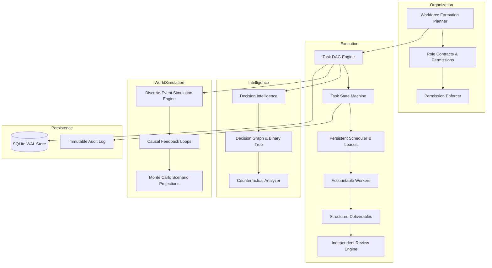

# SimArch Technical Architecture Specification

## 1. Architectural Philosophy

SimArch is built on the premise that autonomous digital workers must be **accountable corporate employees**, not ephemeral conversational agents. Coordination in complex organizations requires:

1. **Explicit Role Contracts**: Boundaries, permissions, decision authority, and budget limits are validated at runtime by the execution engine, not left as prompt suggestions.
2. **Persistent State**: The database is the source of truth, not a model context window or browser session.
3. **Directed Task Graphs**: Tasks have prerequisites, acceptance criteria, verifiable deliverables, and independent review.
4. **Time-Compressed Simulation**: Strategic choices are evaluated across simulated time with explicit causal models before committing real resources.

---

## 2. Subsystem Contracts & Data Flow

---

## 3. Subsystem Specifications

### 3.1 Organization Engine (`simarch.org`)
- **Role Contracts (`RoleContract`)**: Contains role title, tier, reporting relationships (`reports_to_id`), decision scopes, tool permissions, and budget caps.
- **Permission Enforcer (`PermissionEnforcer`)**: Enforces least-privilege runtime security. Validates every tool invocation and decision scope. Prevents privilege escalation.
- **Workforce Formation Planner (`WorkforceFormationPlanner`)**: Parses high-level objectives, classifies domain (engineering, research, operations), and provisions a proportionate workforce.

### 3.2 Workforce Execution Engine (`simarch.execution`)
- **Task State Machine**:
  `PROPOSED -> READY -> ASSIGNED -> RUNNING -> REVIEW -> COMPLETED` (with `BLOCKED`, `RETRYING`, `FAILED`, `CANCELLED` branches).
- **DAG Resolver**: Maintains topological order, verifies acyclicity, and automatically promotes downstream tasks to `READY` when all prerequisites reach `COMPLETED`.
- **Persistent Scheduler**: Worker leases with 30-second heartbeats. Recovers abandoned tasks back to `READY` or marks them `FAILED` after 3 retries.
- **Independent Review Engine**: Audits submitted evidence and deliverables against formal acceptance criteria.

### 3.3 Company Memory & Context Management (`simarch.memory`)
- **Scoped Memory Boundaries**:
  - `ORGANIZATION`: Company-wide policies and governance standards.
  - `DEPARTMENT`: Departmental practices and documentation.
  - `PROJECT`: Strategic initiative context and milestones.
  - `EMPLOYEE`: Private agent notes and intermediate context.
  - `TASK`: Ephemeral execution scratchpad.
- **Contradiction Guard**: Detects direct negations of established assertions and downweights conflicting records during relevance assembly.

### 3.4 Decision Intelligence (`simarch.decision`)
- **Multi-Criteria Utility Scoring**: Evaluates alternatives using weighted criteria.
- **Grounded Winning Rationale**: Documents why the selected alternative won, trade-offs accepted, and exact conditions that would flip the decision.
- **Binary Decision Tree**: Provides direct comparative inspection between the winning option and the runner-up.
- **Counterfactual Analyzer**: Evaluates alternate paths by quantifying cost delta, benefit delta, and risk shifts.

### 3.5 Simulation Architecture (`simarch.simulation`)
- **Discrete-Event Simulation**: Advances simulated clock across days, months, and years directly between relevant events.
- **Causal Business Dynamics**: Connects team size, salaries, marketing spend, customer acquisition cost (CAC), churn rate, product readiness, and cash runway.
- **Monte Carlo Projections**: Executes batches with reproducible random seeds to output $P_{10}$, $P_{50}$ (median), $P_{90}$, and survival probabilities.

### 3.6 Model Routing & Fallback (`simarch.models`)
- **Registry & Complexity Router**: Directs tasks to appropriate models based on priority and cognitive complexity.
- **Deterministic Local Provider**: 100% offline, zero-cost execution engine ensuring all tests and local smoke runs work without paid external API credentials.
